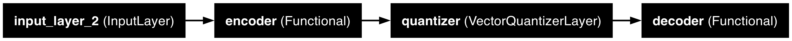
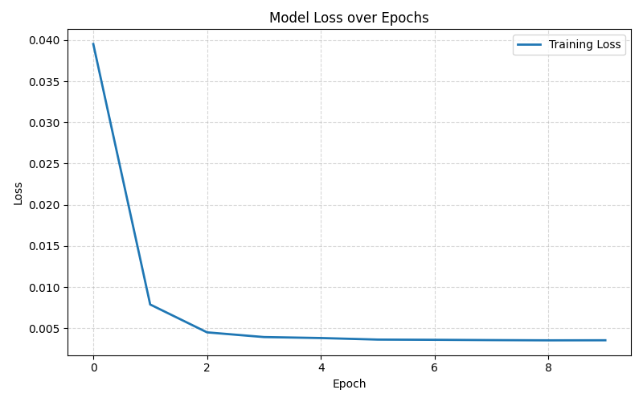
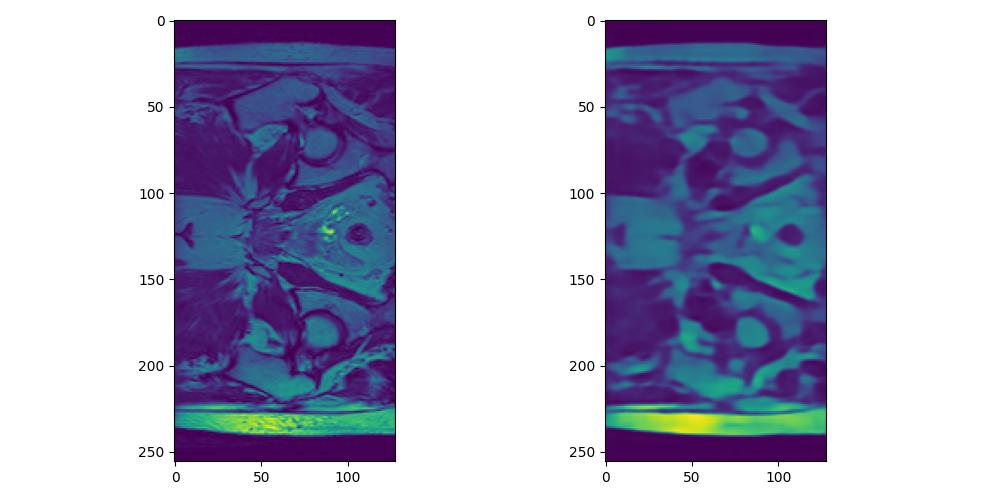
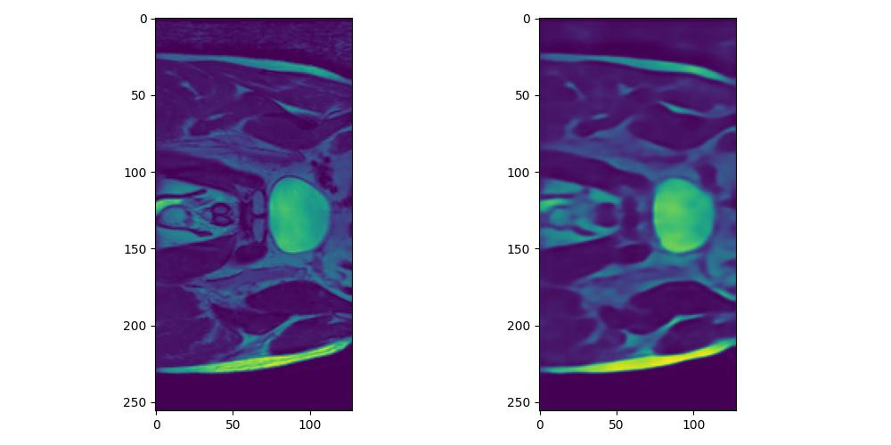
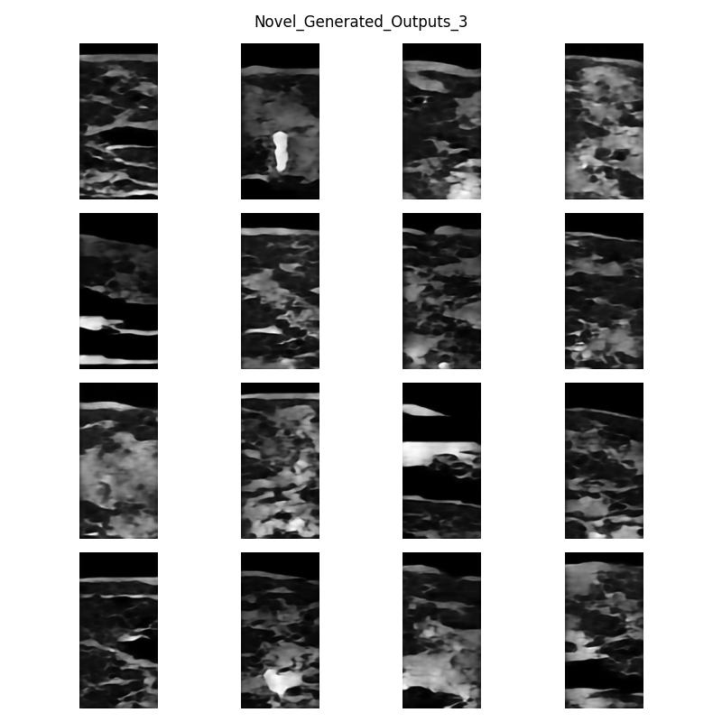
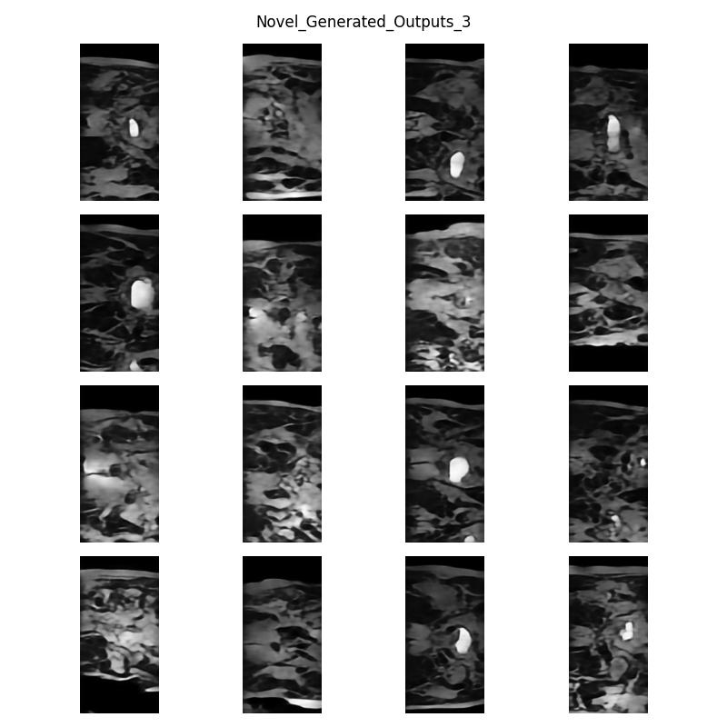

## VQ VAE and PixelCNN Implementation

This completes problem 10 of the COMP3710 (Pattern Recognition) assignment 2025.

All requirements for this project are listed in requirements.txt

#### VQ-VAE

In vq-vae.py, there is the implementation in tf/keras of a vector quantised variational autoencoder. Calling this implementation uses a default architecture designed by me and takes only as hyperparameters the latent dimension (of embeddings) and the number of embeddings (ie codebook size)

The encoder consists of 3 residual blocks each doubling in filters from 128 while halving in spacial dimension. The quantizer takes the embeddings and maps them to the closest of the 512 codebook vectors and the decoder performs the exact operations of the encoder but in reverse (with transpose convolutions). This model was trained for 10 epochs.

The end result are the following reconstructions:

This was tested in ssim-evalution.py and it scored 0.78039 structured similarity across the test set.

This is with 3 halvings in spacial dimension and a latent dimension of 3 corresponding to roughly 21x compression in latent representation (128x256 in image space and 16x32x3 in latent).

#### PixelCNN

Then, in pixel-cnn-generator.py a pixelcnn model was trained on the latent distribution. Attempting to conditionally predict latent vector indices.

The PixelCNN has structure of an initial pixelConvolution layer followed by 8 residual pixelConvolution layers and finally 2 more pixel convolutions. A pixel convolution is a standard convolution with all kernel entries occuring at and after the current pixel being zeroed out. This is what makes the pixelCNN conditional, it may only determine the current output entry by what has come before it. A residual pixel layer is a pixelConvolution inbetween 2 regular convolutions with a skip connection across all.

This PixelCNN trained for ~50 epochs on the latent representation output by the encoder and converged (on the best run) with a loss of ~2.7

unlike other models the convergent error of a pixelcnn scales with the codebook size and so this loss is indicative of a decent model but one still with possible improvement. A perfect model would be closer to 2 for the used codebook size.

then this model can be used in the generate_images function to sample this learned distribution. The sampled indices are selected from the code book and run through the decoder to produce novel examples.

First the examples were very rough

But then by adding one-hot encoding to input, adjusting the temperature of sampling and tweaking the model architecture (to that described above), they could be improved to the following

These have clear features present in hip MRI scans shown above.